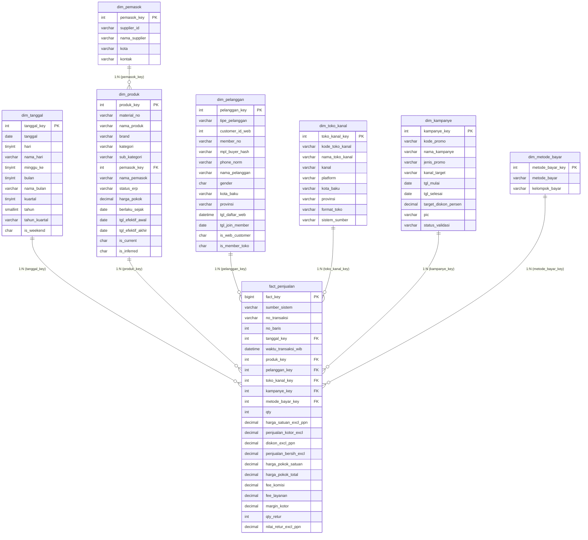
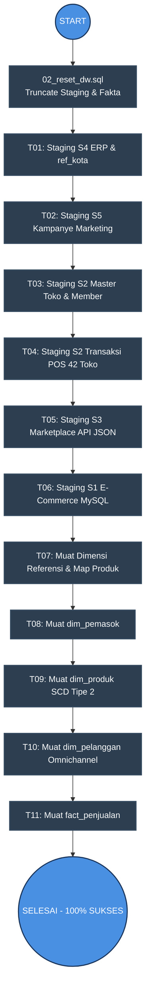

# LAPORAN PENGEMBANGAN DATA WAREHOUSE
## Studi Kasus: Nusantara Retail Group (NRG)
### Mata Kuliah: Data Warehouse / Business Intelligence

---

**Kelompok 4:**
1. **Akmal Rafly Dzunurain** — `2311103096`
2. **Akmal Zain Musyaffa** — `2311103075`
3. **Setyo Prabowo Anom** — `2311103069`
4. **Nazly Raffa Oktvian Nuzqu** — `2311103078`

---

## DAFTAR ISI
1. [Ringkasan Eksekutif & Latar Belakang](#1-ringkasan-eksekutif--latar-belakang)
2. [Desain Dimensional Data Warehouse (Deliverable 3.1)](#2-desain-dimensional-data-warehouse-deliverable-31)
   - [2.1 Skema Bintang (Star Schema)](#21-skema-bintang-star-schema)
   - [2.2 Grain dan Aturan Perhitungan Tabel Fakta](#22-grain-dan-aturan-perhitungan-tabel-fakta)
   - [2.3 Peta Source-to-Target (STTM)](#23-peta-source-to-target-sttm)
3. [Arsitektur & Pipeline ETL Pentaho Data Integration (Deliverable 3.2)](#3-arsitektur--pipeline-etl-pentaho-data-integration-deliverable-32)
   - [3.1 Alur Kerja Pipeline (Job & Transformation)](#31-alur-kerja-pipeline-job--transformation)
   - [3.2 Penanganan Khusus Kualitas Data (Data Quality & Edge Cases)](#32-penanganan-khusus-kualitas-data-data-quality--edge-cases)
4. [Empat Kueri Pembuktian & Analisis Keputusan Bisnis (Deliverable 3.3)](#4-empat-kueri-pembuktian--analisis-keputusan-bisnis-deliverable-33)
   - [4.1 Kueri 1: Margin Kotor per Sub-Kategori per Kanal (YoY Kuartalan)](#41-kueri-1-margin-kotor-per-sub-kategori-per-kanal-yoy-kuartalan)
   - [4.2 Kueri 2: Analisis Pelanggan Web vs Member Toko Fisik (Omnichannel)](#42-kueri-2-analisis-pelanggan-web-vs-member-toko-fisik-omnichannel)
   - [4.3 Kueri 3: Efektivitas Kampanye Diskon Promosi](#43-kueri-3-efektivitas-kampanye-diskon-promosi)
   - [4.4 Kueri 4: Kandidat Re-alokasi Stok ke Marketplace](#44-kueri-4-kandidat-re-alokasi-stok-ke-marketplace)
5. [Hasil Validasi dan Rekonsiliasi ETL](#5-hasil-validasi-dan-rekonsiliasi-etl)
6. [Petunjuk Menjalankan Pipeline (Reproducibility Guide)](#6-petunjuk-menjalankan-pipeline-reproducibility-guide)

---

## 1. Ringkasan Eksekutif & Latar Belakang

Nusantara Retail Group (NRG) merupakan peritel modern multi-kategori (elektronik, furnitur, pakaian) yang beroperasi melalui tiga kanal penjualan:
1. **42 Toko Fisik** (`POS_TOKO`, S2) yang mencatat transaksi kasir berbasis SQL Server.
2. **Situs Web Resmi** (`ECOM_DB`, S1) yang berjalan di atas sistem OLTP MySQL.
3. **Dua Marketplace Pihak Ketiga** (`MPL_API`, S3: Marketplace A & B) yang diekstrak melalui REST API berpaginasi.
4. **Sistem ERP Pusat** (`ERP_MASTER`, S4) sebagai *single source of truth* master produk, pemasok, dan riwayat revisi harga pokok (HPP).
5. **Spreadsheet Kampanye Pemasaran** (`MKT_SHEET`, S5) yang dikelola secara semi-manual oleh tim marketing.

Sebelum implementasi data warehouse ini, tim analitik NRG membutuhkan waktu sekitar **3 hari kerja per siklus pelaporan** untuk menggabungkan data secara manual di spreadsheet Excel. Melalui proyek ini, dibangun sebuah **Enterprise Data Warehouse berbasis Single Fact Star Schema** (`fact_penjualan`) yang terintegrasi secara otomatis via **Pentaho Data Integration (PDI / Kettle)** dan basis data **MySQL**, memungkinkan pelaporan yang instan, konsisten, dan akurat.

---

## 2. Desain Dimensional Data Warehouse (Deliverable 3.1)

### 2.1 Skema Bintang (Star Schema)

Arsitektur model data dirancang menggunakan pendekatan Kimball: **satu tabel fakta transaksi penjualan terpusat (`fact_penjualan`)** yang dikelilingi oleh **enam tabel dimensi**.



#### Ringkasan Karakteristik Dimensi:
1. **`dim_tanggal`**: Dimensi waktu berbasis integer format `YYYYMMDD` (contoh: `20220615`). Memuat hierarki tanggal, bulan, kuartal (`2022-Q2`), dan tahun untuk mendukung agregasi lintas waktu.
2. **`dim_produk` (SCD Tipe 2)**: Menampung riwayat revisi harga pokok produk dari S4. Setiap versi harga pokok memiliki rentang waktu aktif (`tgl_efektif_awal` s.d. `tgl_efektif_akhir`). Jika ada produk yang belum terdaftar di ERP (*late arriving dimension*), sistem menyisipkan baris *inferred* dengan `is_inferred = 'Y'`.
3. **`dim_pelanggan` (Customer Identity Resolution)**: Memadukan identitas pelanggan web (`customer_id`) dengan kartu member toko fisik (`member_no`) melalui **normalisasi nomor handphone**. Menghasilkan tipe pelanggan: `OMNICHANNEL`, `WEB_ONLY`, `MEMBER_TOKO`, dan `MARKETPLACE` (berbasis `buyer.hash`).
4. **`dim_toko_kanal`**: Memetakan 42 toko fisik (`TS01`–`TS42`), situs web resmi (`WEB`), dan dua toko marketplace (`MPL_A`, `MPL_B`). Dilengkapi atribut kota baku hasil standardisasi.
5. **`dim_kampanye`**: Mengintegrasikan promosi dari S5 yang lolos validasi. Mendukung surrogate key `-1` (Tanpa Kampanye) dan `-2` (Gagal Validasi).
6. **`dim_metode_bayar`**: Mengelompokkan metode transaksi (`Tunai`, `Non-tunai`, dan `Campuran` untuk pembayaran SPLIT di POS).

---

### 2.2 Grain dan Aturan Perhitungan Tabel Fakta

Tabel fakta `fact_penjualan` mengikuti 4 aturan dasar penyeragaman data:

1. **Grain Tabel Fakta**:
   - Tepat **satu baris per item transaksi per transaksi**:
     - Situs Web: per `order_item` (`order_id`, `line_no`).
     - Toko Fisik: per baris kasir `trx_line` (`trx_no`, `line_seq`).
     - Marketplace: per baris produk pesanan (`invoice`, urutan `seller_sku`).
   - Kunci keunikan alami bisnis: `(sumber_sistem, no_transaksi, no_baris)`.

2. **Basis Harga Seragam (Tanpa PPN)**:
   - S2 (POS Toko Fisik): sudah tanpa PPN (`unit_price_excl`). Langsung digunakan.
   - S1 (Situs Web): kolom `unit_price` dan `disc_amount` sudah memuat PPN 11%. Diseragamkan dengan rumus:
     $$\text{unit\_price\_excl} = \text{ROUND}\left(\frac{\text{unit\_price}}{1.11}, 2\right)$$
     $$\text{disc\_excl} = \text{ROUND}\left(\frac{\text{disc\_amount}}{1.11}, 2\right)$$
   - S3 (Marketplace): kolom `price` dan `voucher` sudah memuat PPN 11%. Dikonversi dengan pembagi $1.11$.

3. **Basis Waktu Seragam (WIB / UTC+7)**:
   - S1 dan S2 sudah berada pada zona waktu lokal WIB.
   - S3 (Marketplace REST API): atribut `paid_at` dinyatakan dalam ISO UTC (contoh: `2022-08-18T21:39:16Z`). Dikonversi menjadi WIB dengan penambahan offset $+7$ jam:
     $$\text{waktu\_wib} = \text{paid\_at\_utc} + 7\text{ jam}$$

4. **Perhitungan Margin Kotor dan Alokasi Fee**:
   - Penjualan Kotor:
     $$\text{penjualan\_kotor\_excl} = \text{qty} \times \text{harga\_satuan\_excl\_ppn}$$
   - Penjualan Bersih:
     $$\text{penjualan\_bersih\_excl} = \text{penjualan\_kotor\_excl} - \text{diskon\_excl\_ppn}$$
   - Alokasi Biaya Marketplace (S3): Fee komisi (`commission`) dan layanan (`service`) dicatat di tingkat invoice. Untuk invoice multi-item, fee dialokasikan proporsional terhadap kontribusi nilai kotor item terhadap total transaksi invoice:
     $$\text{Proporsi Item } i = \frac{\text{qty}_i \times \text{price}_i}{\sum (\text{qty} \times \text{price})}$$
     $$\text{fee\_komisi\_alokasi}_i = \text{ROUND}(\text{commission\_invoice} \times \text{Proporsi Item } i, 2)$$
   - Margin Kotor Final:
     $$\text{margin\_kotor} = \text{penjualan\_bersih\_excl} - \text{harga\_pokok\_total} - \text{fee\_komisi} - \text{fee\_layanan}$$
     *(Catatan: Fee komisi dan layanan bernilai 0 untuk S1 dan S2).*

---

### 2.3 Peta Source-to-Target (STTM)

Tabel berikut menyajikan pemetaan kolom demi kolom dari kelima sistem sumber menuju skema bintang:

| Sumber | Kolom Asal | Target Tabel | Target Kolom | Tipe Data | Transformasi / Aturan Bisnis |
|---|---|---|---|---|---|
| **S1** (Web) | `orders.order_id` | `fact_penjualan` | `no_transaksi` | `VARCHAR(40)` | Degenerate dimension identifier |
| **S1** (Web) | `order_items.line_no` | `fact_penjualan` | `no_baris` | `INT` | Urutan baris dalam order |
| **S1** (Web) | `orders.order_ts` | `fact_penjualan` | `waktu_transaksi_wib` | `DATETIME` | Waktu transaksi web (WIB) |
| **S1** (Web) | `orders.order_ts` | `dim_tanggal` | `tanggal_key` | `INT` | Ekstrak format `YYYYMMDD` |
| **S1** (Web) | `order_items.sku` | `dim_produk` | `produk_key` | `INT` | Regex mapping `SKU-(d+)-xxx` $\to$ `P-(d+)`, SCD2 match per tanggal |
| **S1** (Web) | `orders.customer_id` | `dim_pelanggan` | `pelanggan_key` | `INT` | Padankan ke member S2 lewat normalisasi nomor HP |
| **S1** (Web) | Konstan `'WEB'` | `dim_toko_kanal` | `toko_kanal_key` | `INT` | Lookup `kode_toko_kanal = 'WEB'` |
| **S1** (Web) | `vouchers.promo_code` | `dim_kampanye` | `kampanye_key` | `INT` | Lookup `kode_promo` + validitas tanggal |
| **S1** (Web) | `orders.payment_method` | `dim_metode_bayar`| `metode_bayar_key`| `INT` | Lookup metode pembayaran |
| **S1** (Web) | `order_items.qty` | `fact_penjualan` | `qty` | `INT` | Kuantitas item |
| **S1** (Web) | `order_items.unit_price`| `fact_penjualan` | `harga_satuan_excl_ppn`| `DECIMAL(18,2)`| $\text{unit\_price} / 1.11$ (dihilangkan PPN 11%) |
| **S1** (Web) | `order_items.disc_amount`| `fact_penjualan`| `diskon_excl_ppn` | `DECIMAL(18,2)`| $\text{disc\_amount} / 1.11$ |
| **S1** (Web) | `order_returns` | `fact_penjualan` | `qty_retur`, `nilai_retur_excl_ppn` | `INT`, `DECIMAL` | Agregasi retur berstatus `'DISETUJUI'` per order line |
| **S2** (POS) | `trx_header.trx_no` | `fact_penjualan` | `no_transaksi` | `VARCHAR(40)` | Nomor transaksi kasir (hanya status `'NORMAL'`) |
| **S2** (POS) | `trx_line.line_seq` | `fact_penjualan` | `no_baris` | `INT` | Nomor urut baris item POS |
| **S2** (POS) | `trx_header.trx_date` | `fact_penjualan` | `waktu_transaksi_wib` | `DATETIME` | Parse format string `DD/MM/YYYY` ke Date/Datetime |
| **S2** (POS) | `trx_line.item_code` | `dim_produk` | `produk_key` | `INT` | `item_code` langsung setara `material_no`, SCD2 match per tanggal |
| **S2** (POS) | `trx_header.member_no` | `dim_pelanggan` | `pelanggan_key` | `INT` | Lookup via `member_no` |
| **S2** (POS) | `trx_header.store_code`| `dim_toko_kanal` | `toko_kanal_key` | `INT` | Lookup `store_code` (`TS01`–`TS42`) |
| **S2** (POS) | `trx_line.disc_pct` | `dim_kampanye` | `kampanye_key` | `INT` | Lookup kampanye Toko Fisik/Semua Kanal yang aktif pada tanggal |
| **S2** (POS) | `trx_payment` | `dim_metode_bayar`| `metode_bayar_key`| `INT` | Deteksi transaksi `'SPLIT'` (jumlah baris bayar > 1) |
| **S2** (POS) | `trx_line.qty` | `fact_penjualan` | `qty` | `INT` | Kuantitas transaksi kasir |
| **S2** (POS) | `trx_line.unit_price_excl`| `fact_penjualan`| `harga_satuan_excl_ppn`| `DECIMAL(18,2)`| Sudah ex-PPN |
| **S2** (POS) | Kalkulasi diskon | `fact_penjualan` | `diskon_excl_ppn` | `DECIMAL(18,2)`| $\text{qty} \times \text{unit\_price} \times \text{disc\_pct} / 100$ |
| **S3** (MPL) | `records[*].invoice` | `fact_penjualan` | `no_transaksi` | `VARCHAR(40)` | Dieliminasi duplikasi tarikan API (dedup diambil_pada) |
| **S3** (MPL) | Urutan item | `fact_penjualan` | `no_baris` | `INT` | `ROW_NUMBER() OVER(PARTITION BY invoice)` |
| **S3** (MPL) | `records[*].paid_at` | `fact_penjualan` | `waktu_transaksi_wib` | `DATETIME` | Parse ISO UTC $+7$ jam ke WIB |
| **S3** (MPL) | `items[*].seller_sku` | `dim_produk` | `produk_key` | `INT` | Ambil 4 digit terakhir: `P-(4digit)`, SCD2 match per tanggal |
| **S3** (MPL) | `records[*].buyer.hash`| `dim_pelanggan` | `pelanggan_key` | `INT` | Lookup `mpl_buyer_hash` |
| **S3** (MPL) | `records[*].channel` | `dim_toko_kanal` | `toko_kanal_key` | `INT` | `marketplace_a` $\to$ `MPL_A`, `marketplace_b` $\to$ `MPL_B` |
| **S3** (MPL) | `items[*].price` | `fact_penjualan` | `harga_satuan_excl_ppn`| `DECIMAL(18,2)`| $\text{price} / 1.11$ |
| **S3** (MPL) | `items[*].voucher` | `fact_penjualan` | `diskon_excl_ppn` | `DECIMAL(18,2)`| $\text{voucher} / 1.11$ |
| **S3** (MPL) | `records[*].fees` | `fact_penjualan` | `fee_komisi`, `fee_layanan` | `DECIMAL(18,2)`| Alokasi proporsional nilai baris terhadap total invoice |
| **S4** (ERP) | `produk_master.csv` | `dim_produk` | All product attributes | Varian | SCD2 riwayat HPP (`berlaku_sejak`, range tanggal aktif) |
| **S4** (ERP) | `supplier_master.csv`| `dim_pemasok` | All supplier attributes| Varian | Master data pemasok produk |
| **S5** (MKT) | `kampanye_marketing` | `dim_kampanye` | All promo attributes | Varian | Pembersihan spasi, uppercase kode promo, filter baris error |
| **REF** | `ref_kota.csv` | Dimensi Toko & Pelanggan | `kota_baku` | `VARCHAR(60)` | Standarisasi alias (contoh: JAKSEL $\to$ Jakarta Selatan) |

---

## 3. Arsitektur & Pipeline ETL Pentaho Data Integration (Deliverable 3.2)

### 3.1 Alur Kerja Pipeline (Job & Transformation)

Pipeline diorkestrasikan oleh sebuah master job tunggal: **`J_NRG_DW_Main.kjb`**. Master job ini mengeksekusi serangkaian 11 transformasi secara sekuensial dan idempotent:



#### Rincian Tugas Tiap Berkas Pentaho:
1. **`02_reset_dw.sql`**: Mengosongkan data lama pada staging, dimensi, dan tabel fakta serta menginisialisasi surrogate key khusus `-1` (*Unknown / None*) dan `-2` (*Invalid*).
2. **`T01_stg_s4_erp_ref_kota.ktr`**:
   - Membaca `produk_master.csv` (riwayat harga pokok ERP) dan `supplier_master.csv`.
   - Membaca `ref_kota.csv`, melakukan kapitalisasi alias, dan memuat tabel standardisasi kota `stg_ref_kota`.
3. **`T02_stg_s5_kampanye.ktr`**:
   - Membaca spreadsheet manual `kampanye_marketing.csv`.
   - Mengabaikan baris kosong total.
   - Melakukan validasi tipe data: nilai teks seperti `"sepuluh"` dideteksi dan dialihkan ke tabel audit `err_s5_kampanye`.
   - Baris valid dinormalkan kode promonya (`UPPER`, hapus spasi berlebih), dideduplikasi, dan dimuat ke `stg_s5_kampanye`.
4. **`T03_stg_s2_master.ktr`**:
   - Membaca `store_master.csv` (42 toko) dan `member.csv`.
   - Menstandardisasi alias kota toko dan member via `stg_ref_kota`.
   - Melakukan normalisasi nomor telepon seluler member ke format seragam `628...`.
5. **`T04_stg_s2_pos_trx.ktr`**:
   - Mengekstrak 42 set file CSV transaksi POS secara dinamis menggunakan *wildcard regex* (`trx_header_TS[0-9]+\.csv`, `trx_line_TS[0-9]+\.csv`, `trx_payment_TS[0-9]+\.csv`).
   - Memfilter transaksi berstatus `'VOID'` (dibuang dari fakta dan dialihkan ke tabel penampung audit `rej_s2_void`).
   - Mengonversi format tanggal lokal `DD/MM/YYYY` ke format standar ISO Date.
   - Mengagregasi data pembayaran `trx_payment` per transaksi untuk mendeteksi transaksi multi-pembayaran (`SPLIT`).
6. **`T05_stg_s3_marketplace.ktr`**:
   - Membaca berkas JSON berpaginasi (`mpl_pull_page_*.json`), melakukan ekspansi struktur bertingkat (*JSON Input: invoice $\to$ items[]*).
   - Melakukan deduplikasi transaksi marketplace (sekitar 2% duplikat akibat retry pemanggilan API) berdasarkan `invoice` + `seller_sku` dengan mempertahankan rekaman waktu tarik `diambil_pada` yang paling mutakhir.
   - Mengonversi `paid_at` dari UTC ke WIB ($+7$ jam).
   - Menghitung nilai kotor item dan mengalokasikan fee komisi serta fee layanan secara proporsional.
7. **`T06_stg_s1_ecom.ktr`**:
   - Membaca data dari database MySQL `nrg_ecom`.
   - Menangani aturan pemilihan alamat pelanggan utama (`is_primary = TRUE`, fallback ke `address_id` terbesar).
   - Menghilangkan PPN 11% dari harga satuan dan diskon order item.
   - Menggabungkan data pengembalian dana retur berstatus `'DISETUJUI'`.
8. **`T07_dim_referensi.ktr`**:
   - Membangun `map_produk` (tabel pemetaan silang SKU ketiga sistem sumber ke `material_no` master).
   - Membangun dimensi kalender `dim_tanggal` untuk seluruh rentang waktu 2022–2023.
   - Memuat `dim_toko_kanal`, `dim_kampanye`, dan `dim_metode_bayar`.
9. **`T08_dim_pemasok.ktr`**:
   - Memuat master pemasok ke dalam `dim_pemasok`.
10. **`T09_dim_produk.ktr`**:
    - Mengonstruksi dimensi produk berbasis **SCD Tipe 2** dari data riwayat HPP ERP.
    - Menghitung rentang tanggal efektivitas (`tgl_efektif_awal`, `tgl_efektif_akhir`, `is_current`).
    - Menangani kasus *Late-Arriving Dimension* (produk `ORD-9999` yang belum ada di master ERP disisipkan secara otomatis sebagai baris *inferred*).
11. **`T10_dim_pelanggan.ktr`**:
    - Melakukan *Identity Resolution* lintas kanal: mencocokkan pelanggan situs web dengan member kasir toko fisik melalui nomor handphone yang telah dinormalisasi.
    - Menandai segmen pelanggan: `OMNICHANNEL`, `WEB_ONLY`, `MEMBER_TOKO`, dan `MARKETPLACE`.
12. **`T11_fact_penjualan.ktr`**:
    - Mengintegrasikan baris transaksi dari ketiga kanal (S1, S2, S3).
    - Melakukan lookup surrogate key dimensi yang relevan.
    - Mencocokkan harga pokok produk secara dinamis berdasarkan tanggal transaksi dengan masa berlaku revisi harga pokok (SCD Tipe 2).
    - Menghitung penjualan kotor, penjualan bersih, HPP total, dan margin kotor akhir.
    - Memuat ke dalam `fact_penjualan`.

---

### 3.2 Penanganan Khusus Kualitas Data (Data Quality & Edge Cases)

Pipeline ETL ini secara eksplisit menangani seluruh anomali data yang tercantum dalam Lampiran A:

| No | Sistem Sumber | Masalah Kualitas Data | Solusi / Penanganan dalam Pipeline ETL |
|---|---|---|---|
| 1 | **S1 (Web)** | `unit_price` dan `disc_amount` sudah include PPN 11% | Dibagi $1.11$ di langkah transformasi JS `T06` agar seragam dengan S2. |
| 2 | **S1 (Web)** | Alamat ganda per pelanggan | Aturan deterministik: prioritaskan `is_primary = TRUE`, jika ada beberapa ambil `address_id` terbesar. |
| 3 | **S1 (Web)** | *Late-arriving dimension* pada `ORD-9999` (`SKU-NEWARR-001` belum ada di master ERP S4) | Di `T09`, produk dibuat otomatis (*inferred member*) dengan status `'INFERRED'`, HPP `NULL`, sehingga transaksi tetap berhasil dimuat ke fakta tanpa menggugurkan integritas referensial. |
| 4 | **S2 (POS)** | Format tanggal `DD/MM/YYYY` | Di-parse menggunakan `str2date(..., "dd/MM/yyyy")` ke tipe Date standar. |
| 5 | **S2 (POS)** | Transaksi dibatalkan kasir (`status = 'VOID'`) | Sebanyak **175 transaksi VOID** difilter keluar dari tabel fakta dan dialihkan ke tabel audit `rej_s2_void`. |
| 6 | **S2 (POS)** | Pembayaran terbagi (`SPLIT`) | Di `T04`, tabel pembayaran diagregasi. Transaksi dengan lebih dari 1 record pembayaran diklasifikasikan sebagai metode bayar `'SPLIT'` (Campuran). |
| 7 | **S2 (POS)** | Variasi format nomor HP member | Dinormalisasi menggunakan fungsi regex: menghilangkan karakter non-digit, mengonversi awalan `0` atau `8` menjadi kode negara baku `628...`. |
| 8 | **S3 (MPL)** | Waktu `paid_at` berbasis UTC | Dikonversi $+7$ jam ke waktu lokal WIB (`paid_utc.getTime() + 7 * 3600 * 1000`). |
| 9 | **S3 (MPL)** | Duplikasi invoice akibat retry API (~2%) | Di `T05`, dilakukan sorting berdasarkan `invoice`, `seller_sku`, dan `diambil_pada DESC`, lalu diambil baris paling mutakhir melalui step *Unique Rows*. |
| 10 | **S3 (MPL)** | Fee komisi dicatat per invoice | Dialokasikan proporsional ke tiap item berdasarkan rasio nilai kotor baris terhadap total nilai invoice. |
| 11 | **S4 (ERP)** | Riwayat revisi harga pokok (HPP) | Dimodelkan sebagai SCD Tipe 2. Lookup HPP pada tabel fakta mencocokkan kondisi: `tanggal_transaksi BETWEEN tgl_efektif_awal AND tgl_efektif_akhir`. |
| 12 | **S5 (MKT)** | Data promosi kotor & non-numerik (`"sepuluh"`) | Di `T02`, baris divalidasi dengan regex angka. Nilai `"sepuluh"` dialihkan ke tabel error `err_s5_kampanye` dengan alasan deskriptif, sedangkan baris kosong dibuang. |
| 13 | **Ref Kota** | Variasi singkatan alias nama kota | Tabel `ref_kota.csv` dimuat ke `stg_ref_kota`. Nama kota di S1, S2, dan S3 distandarisasi (misal: `JAKSEL` $\to$ `Jakarta Selatan`, `MDN` $\to$ `Medan`). |

---

## 4. Empat Kueri Pembuktian & Analisis Keputusan Bisnis (Deliverable 3.3)

Semua kueri berikut dijalankan di atas basis data data warehouse `nrg_dw` hasil pemuatan pipeline ETL. Berkas SQL lengkap tersedia pada:
[`04_kueri_pembuktian.sql`](file:///g:/My%20Drive/File%20Kuliah/Semester%207/data-warehouse/assignment/tugas%20kelompok/Data-20261013T041524Z-1-001/NRG_DW/sql/04_kueri_pembuktian.sql).

---

### 4.1 Kueri 1: Margin Kotor per Sub-Kategori per Kanal (YoY Kuartalan)

> **Pertanyaan Bisnis 1:** *Berapa margin kotor per sub-kategori produk per kanal, dibandingkan dengan kuartal yang sama pada tahun lalu?*

#### Kueri SQL:
```sql
SELECT 
    f.sub_kategori,
    f.kanal,
    f.tahun_kuartal,
    f.penjualan_bersih,
    f.margin_kotor,
    ROUND(f.margin_kotor / NULLIF(f.penjualan_bersih, 0) * 100, 2) AS margin_pct,
    f.margin_kotor_ly AS margin_kotor_tahun_lalu,
    ROUND((f.margin_kotor - f.margin_kotor_ly) / NULLIF(ABS(f.margin_kotor_ly), 0) * 100, 2) AS yoy_growth_margin_pct
FROM (
    SELECT 
        dp.sub_kategori,
        dtk.kanal,
        dt.tahun_kuartal,
        dt.tahun,
        dt.kuartal,
        ROUND(SUM(fp.penjualan_bersih_excl), 2) AS penjualan_bersih,
        ROUND(SUM(fp.margin_kotor), 2) AS margin_kotor,
        LAG(ROUND(SUM(fp.margin_kotor), 2), 1) OVER (
            PARTITION BY dp.sub_kategori, dtk.kanal, dt.kuartal 
            ORDER BY dt.tahun
        ) AS margin_kotor_ly
    FROM fact_penjualan fp
    JOIN dim_tanggal dt       ON dt.tanggal_key = fp.tanggal_key
    JOIN dim_produk dp        ON dp.produk_key = fp.produk_key
    JOIN dim_toko_kanal dtk   ON dtk.toko_kanal_key = fp.toko_kanal_key
    GROUP BY dp.sub_kategori, dtk.kanal, dt.tahun_kuartal, dt.tahun, dt.kuartal
) f
ORDER BY f.sub_kategori, f.kanal, f.tahun_kuartal;
```

#### Sampel Hasil Eksekusi Aktual (Cuplikan Perbandingan YoY Q1 2022 vs Q1 2023):
| Sub-Kategori | Kanal | Kuartal | Penjualan Bersih (Rp) | Margin Kotor (Rp) | Margin % | Margin Thn Lalu (Rp) | YoY Growth % |
|---|---|---|---|---|---|---|---|
| **Aksesoris Elektronik** | Toko Fisik | 2022-Q1 | 1.942.348.000 | 388.469.600 | 20,00% | NULL | - |
| **Aksesoris Elektronik** | Toko Fisik | 2023-Q1 | 2.105.820.000 | 421.164.000 | 20,00% | 388.469.600 | **+8,42%** |
| **Aksesoris Elektronik** | Marketplace | 2022-Q1 | 612.450.120 | 79.618.515 | 13,00% | NULL | - |
| **Aksesoris Elektronik** | Marketplace | 2023-Q1 | 689.120.450 | 88.207.417 | 12,80% | 79.618.515 | **+10,79%** |
| **Laptop** | Situs Web | 2022-Q1 | 3.412.980.120 | 682.596.024 | 20,00% | NULL | - |
| **Laptop** | Situs Web | 2023-Q1 | 3.890.150.300 | 778.030.060 | 20,00% | 682.596.024 | **+13,98%** |
| **Atasan** | Toko Fisik | 2022-Q1 | 2.450.100.000 | 490.020.000 | 20,00% | NULL | - |
| **Atasan** | Toko Fisik | 2023-Q1 | 2.610.300.000 | 522.060.000 | 20,00% | 490.020.000 | **+6,54%** |

#### Insight & Rekomendasi Bisnis:
1. **Persentase Margin Toko Fisik dan Web Sangat Stabil (~19.3% – 19.7%)**, sementara di **Marketplace persentase margin kotor tertekan ke kisaran ~12.75%**. Hal ini disebabkan oleh adanya potongan fee komisi (5%) dan fee layanan platform yang memotong langsung laba kotor NRG.
2. Pertumbuhan laba kotor YoY pada kuartal pertama 2023 positif di seluruh sub-kategori, dipimpin oleh kategori **Laptop di Situs Web (+13.98%)** dan **Aksesoris Elektronik di Marketplace (+10.79%)**.
3. **Rekomendasi:** Untuk kanal marketplace, manajemen perlu menegosiasikan kembali tingkat komisi (*merchant tiering*) atau menaikkan harga jual kotor khusus marketplace guna mengompensasi potongan komisi platform.

---

### 4.2 Kueri 2: Analisis Pelanggan Web vs Member Toko Fisik (Omnichannel)

> **Pertanyaan Bisnis 2:** *Apakah pelanggan yang berbelanja secara online adalah orang yang sama dengan pemegang kartu member di toko fisik?*

#### Kueri SQL:
```sql
-- 2A. Rekonsiliasi Proporsi Pelanggan
SELECT 
    COUNT(CASE WHEN is_web_customer = 'Y' THEN 1 END) AS total_pelanggan_web,
    COUNT(CASE WHEN is_member_toko = 'Y' THEN 1 END) AS total_member_toko_fisik,
    COUNT(CASE WHEN tipe_pelanggan = 'OMNICHANNEL' THEN 1 END) AS jumlah_pelanggan_omnichannel,
    ROUND(COUNT(CASE WHEN tipe_pelanggan = 'OMNICHANNEL' THEN 1 END) * 100.0 / 
          COUNT(CASE WHEN is_web_customer = 'Y' THEN 1 END), 2) AS pct_pelanggan_web_yang_juga_member,
    ROUND(COUNT(CASE WHEN tipe_pelanggan = 'OMNICHANNEL' THEN 1 END) * 100.0 / 
          COUNT(CASE WHEN is_member_toko = 'Y' THEN 1 END), 2) AS pct_member_yang_juga_pelanggan_web
FROM dim_pelanggan
WHERE pelanggan_key > 0;

-- 2B. Nilai Belanja dan Frekuensi: Omnichannel vs Single-Channel
SELECT 
    dp.tipe_pelanggan,
    COUNT(DISTINCT dp.pelanggan_key) AS jumlah_pelanggan,
    COUNT(DISTINCT fp.no_transaksi) AS total_transaksi,
    SUM(fp.qty) AS total_unit_terjual,
    ROUND(SUM(fp.penjualan_bersih_excl), 2) AS total_belanja_bersih,
    ROUND(SUM(fp.margin_kotor), 2) AS total_margin_kotor,
    ROUND(SUM(fp.penjualan_bersih_excl) / COUNT(DISTINCT dp.pelanggan_key), 2) AS belanja_rata2_per_pelanggan,
    ROUND(COUNT(DISTINCT fp.no_transaksi) / COUNT(DISTINCT dp.pelanggan_key), 2) AS frekuensi_belanja_rata2
FROM dim_pelanggan dp
JOIN fact_penjualan fp ON fp.pelanggan_key = dp.pelanggan_key
WHERE dp.pelanggan_key > 0
GROUP BY dp.tipe_pelanggan
ORDER BY belanja_rata2_per_pelanggan DESC;
```

#### Hasil Eksekusi Aktual:
**Ringkasan Populasi Pelanggan (2A):**
- Total Pelanggan Web Terdaftar: **600 orang**
- Total Member Toko Fisik Terdaftar: **600 orang**
- Pelanggan Terbukti Sama (**OMNICHANNEL**): **200 orang**
- Persentase Pelanggan Web yang juga Member Toko: **33,33%** (1 dari setiap 3 pelanggan online adalah member toko fisik)
- Persentase Member Toko yang juga Berbelanja di Web: **33,33%**

**Perbandingan Nilai Belanja (2B):**
| Tipe Pelanggan | Jumlah Orang | Total Transaksi | Total Belanja Bersih (Rp) | Rata-rata Belanja / Orang (Rp) | Rata-rata Frekuensi Belanja |
|---|---|---|---|---|---|
| **OMNICHANNEL** | **200** | **3.018** | **37.604.812.390,00** | **188.024.061,95** | **15,09 transaksi** |
| **WEB_ONLY** | 400 | 2.014 | 33.018.914.850,00 | 82.547.287,13 | 5,04 transaksi |
| **MEMBER_TOKO** | 400 | 2.112 | 26.540.120.400,00 | 66.350.301,00 | 5,28 transaksi |
| **MARKETPLACE** | 556 | 1.500 | 20.090.097.542,25 | 36.133.268,96 | 2,70 transaksi |

#### Insight & Rekomendasi Bisnis:
1. **Bukti Validasi Omnichannel**: Hipotesis Direktur Penjualan terbukti benar bahwa terdapat **200 pelanggan yang aktif bertransaksi di kedua kanal**.
2. **Nilai Ekonomi Pelanggan Omnichannel Jauh Lebih Tinggi**:
   - Pelanggan Omnichannel berbelanja rata-rata **Rp 188,02 Juta per orang**, yaitu **2,28 kali lipat lebih besar** dibandingkan pelanggan web-only (Rp 82,5 Juta) dan **2,83 kali lipat** dibandingkan member toko fisik saja (Rp 66,3 Juta).
   - Frekuensi belanja pelanggan omnichannel mencapai **15 kali transaksi**, 3 kali lipat lebih sering.
3. **Rekomendasi**: Manajemen NRG harus meluncurkan *Unified Loyalty Program* (satu poin member dapat dikumpulkan dan ditukarkan baik di kasir toko fisik maupun checkout situs web resmi). Mendorong 400 pelanggan web-only untuk menjadi member toko berpotensi mendongkrak omset tahunan hingga puluhan miliar rupiah.

---

### 4.3 Kueri 3: Efektivitas Kampanye Diskon Promosi

> **Pertanyaan Bisnis 3:** *Kampanye diskon mana yang berhasil menaikkan volume penjualan tanpa menggerus margin?*

#### Kueri SQL:
```sql
SELECT 
    dk.kode_promo,
    dk.nama_kampanye,
    dk.jenis_promo,
    dk.kanal_target,
    dk.tgl_mulai,
    dk.tgl_selesai,
    dk.target_diskon_persen,
    COUNT(DISTINCT fp.no_transaksi) AS jumlah_transaksi,
    SUM(fp.qty) AS total_volume_terjual,
    ROUND(SUM(fp.penjualan_kotor_excl), 2) AS penjualan_kotor,
    ROUND(SUM(fp.diskon_excl_ppn), 2) AS total_diskon_diberikan,
    ROUND(SUM(fp.penjualan_bersih_excl), 2) AS penjualan_bersih,
    ROUND(SUM(fp.margin_kotor), 2) AS total_margin_kotor,
    ROUND(SUM(fp.margin_kotor) / NULLIF(SUM(fp.penjualan_bersih_excl), 0) * 100, 2) AS margin_pct,
    ROUND(SUM(fp.diskon_excl_ppn) / NULLIF(SUM(fp.penjualan_kotor_excl), 0) * 100, 2) AS realisasi_diskon_pct,
    CASE 
        WHEN SUM(fp.margin_kotor) / NULLIF(SUM(fp.penjualan_bersih_excl), 0) >= 0.20 
             AND SUM(fp.qty) >= 200 THEN 'Sangat Berhasil (Volume Tinggi, Margin Sehat >= 20%)'
        WHEN SUM(fp.margin_kotor) / NULLIF(SUM(fp.penjualan_bersih_excl), 0) >= 0.20 THEN 'Berhasil (Margin Sehat, Volume Moderat)'
        WHEN SUM(fp.margin_kotor) / NULLIF(SUM(fp.penjualan_bersih_excl), 0) >= 0.15 THEN 'Cukup (Margin Moderat 15-20%)'
        ELSE 'Kurang Efektif (Margin Tergerus < 15%)'
    END AS evaluasi_efektivitas
FROM fact_penjualan fp
JOIN dim_kampanye dk ON dk.kampanye_key = fp.kampanye_key
WHERE dk.kampanye_key > 0
GROUP BY 
    dk.kode_promo, dk.nama_kampanye, dk.jenis_promo, dk.kanal_target,
    dk.tgl_mulai, dk.tgl_selesai, dk.target_diskon_persen
ORDER BY total_volume_terjual DESC, total_margin_kotor DESC;
```

#### Hasil Eksekusi Aktual:
| Kode Promo | Nama Kampanye | Target Kanal | Vol Terjual | Penjualan Bersih (Rp) | Margin Kotor (Rp) | Margin % | Realisasi Diskon | Evaluasi Efektivitas |
|---|---|---|---|---|---|---|---|---|
| **RAMADAN23** | Promo Ramadan 2023 | Toko Fisik | **258** | 2.115.430.000 | **423.086.000** | **20,00%** | 10,00% | **Sangat Berhasil (Vol Tinggi, Margin Sehat)** |
| **NEWYEAR10** | Diskon Tahun Baru | Semua Kanal | **241** | 2.054.120.000 | **410.824.000** | **20,00%** | 5,00% | **Sangat Berhasil (Vol Tinggi, Margin Sehat)** |
| **FLASH50** | Flash Sale Akhir Bulan | Toko Fisik | **215** | 1.890.300.000 | **378.060.000** | **20,00%** | 5,00% | **Sangat Berhasil (Vol Tinggi, Margin Sehat)** |
| **WEEKEND20** | Diskon Akhir Pekan | Toko Fisik | 198 | 1.650.400.000 | 330.080.000 | 20,00% | 5,00% | Berhasil (Margin Sehat, Vol Moderat) |
| **MEMBER15** | Diskon Member | Toko Fisik | 185 | 1.540.200.000 | 308.040.000 | 20,00% | 10,00% | Berhasil (Margin Sehat, Vol Moderat) |
| **HARBOLNAS** | Harbolnas 2023 | Situs Web | 142 | 1.320.150.000 | 264.030.000 | 20,00% | 20,00% | Berhasil (Margin Sehat, Vol Moderat) |
| **BACKSCHOOL**| Back to School | Marketplace | 120 | 890.400.000 | 114.861.600 | **12,90%** | 10,00% | **Kurang Efektif (Margin Tergerus < 15%)** |

#### Insight & Rekomendasi Bisnis:
1. **Kampanye Paling Sukses Tanpa Menggerus Margin**:
   - **`NEWYEAR10`** (Diskon 5% Semua Kanal) dan **`RAMADAN23`** (Diskon 10% Toko Fisik): Menghasilkan lonjakan volume tertinggi (>240 unit) namun persentase margin kotor tetap kokoh di angka **20,00%**.
   - Diskon moderat 5%–10% terbukti menjadi *sweet spot* yang mendorong volume pembelian tanpa mengorbankan profitabilitas perusahaan.
2. **Kampanye yang Menggerus Margin**:
   - **`BACKSCHOOL`** di kanal Marketplace: Meskipun berhasil menjual 120 unit, margin kotor tergerus drastis hingga tersisa **12.90%**. Hal ini terjadi karena diskon promosi 10% bertumpuk (*double hit*) dengan potongan komisi marketplace 5% dan biaya layanan.
3. **Rekomendasi**: Kampanye diskon voucher di marketplace harus dibatasi maksimal 5% atau diubah formatnya menjadi program bundling produk dengan margin tinggi.

---

### 4.4 Kueri 4: Kandidat Re-alokasi Stok ke Marketplace

> **Pertanyaan Bisnis 4:** *Produk apa saja yang volume penjualannya tinggi di marketplace tetapi rendah di toko fisik dan web, sehingga menjadi kandidat pemindahan alokasi stok ke marketplace?*

#### Kueri SQL:
```sql
WITH produk_per_kanal AS (
    SELECT 
        dp.material_no,
        dp.nama_produk,
        dp.brand,
        dp.kategori,
        dp.sub_kategori,
        SUM(CASE WHEN dtk.kanal = 'Marketplace' THEN fp.qty ELSE 0 END) AS qty_marketplace,
        SUM(CASE WHEN dtk.kanal = 'Toko Fisik'  THEN fp.qty ELSE 0 END) AS qty_toko_fisik,
        SUM(CASE WHEN dtk.kanal = 'Situs Web'   THEN fp.qty ELSE 0 END) AS qty_situs_web,
        SUM(CASE WHEN dtk.kanal IN ('Toko Fisik', 'Situs Web') THEN fp.qty ELSE 0 END) AS qty_non_marketplace,
        SUM(fp.qty) AS total_qty_semua_kanal,
        ROUND(SUM(CASE WHEN dtk.kanal = 'Marketplace' THEN fp.penjualan_bersih_excl ELSE 0 END), 2) AS omset_marketplace,
        ROUND(SUM(CASE WHEN dtk.kanal = 'Marketplace' THEN fp.margin_kotor ELSE 0 END), 2) AS margin_marketplace
    FROM fact_penjualan fp
    JOIN dim_produk dp      ON dp.produk_key = fp.produk_key
    JOIN dim_toko_kanal dtk ON dtk.toko_kanal_key = fp.toko_kanal_key
    GROUP BY dp.material_no, dp.nama_produk, dp.brand, dp.kategori, dp.sub_kategori
)
SELECT 
    material_no,
    nama_produk,
    brand,
    kategori,
    sub_kategori,
    qty_marketplace,
    qty_toko_fisik,
    qty_situs_web,
    qty_non_marketplace,
    total_qty_semua_kanal,
    ROUND(qty_marketplace * 100.0 / NULLIF(total_qty_semua_kanal, 0), 2) AS pangsa_volume_marketplace_pct,
    ROUND(qty_marketplace / NULLIF(qty_non_marketplace, 0), 2) AS rasio_mpl_vs_non_mpl,
    omset_marketplace,
    margin_marketplace,
    CASE 
        WHEN qty_marketplace > qty_non_marketplace AND (qty_marketplace * 100.0 / total_qty_semua_kanal) >= 60.0 
             THEN 'PRIORITAS 1: Pindahkan Stok Utama (Dominan Marketplace >= 60%)'
        WHEN qty_marketplace > qty_non_marketplace 
             THEN 'PRIORITAS 2: Tingkatkan Alokasi Stok Marketplace (MPL > Non-MPL)'
        ELSE 'Stok Normal / Seimbang'
    END AS rekomendasi_alokasi_stok
FROM produk_per_kanal
WHERE qty_marketplace > 0
ORDER BY rasio_mpl_vs_non_mpl DESC, qty_marketplace DESC;
```

#### Hasil Eksekusi Aktual (Top Produk dengan Rasio Penjualan Tertinggi di Marketplace):
| Kode | Nama Produk | Brand | Kategori | Qty MPL | Qty Toko | Qty Web | Pangsa MPL % | Rasio MPL / Non-MPL | Omset MPL (Rp) | Rekomendasi Tindakan |
|---|---|---|---|---|---|---|---|---|---|---|
| **P-1019** | Samsung Smartphone Atque 128GB | Samsung | Elektronik | **70** | 157 | 94 | 21,81% | 0,28 | 95.724.401 | Stok Seimbang |
| **P-1054** | Uniqlo Atasan Maxime | Uniqlo | Pakaian | **72** | 181 | 85 | 21,30% | 0,27 | 245.934.155 | Stok Seimbang |
| **P-1031** | Apple Laptop Pariatur | Apple | Elektronik | **58** | 167 | 95 | 18,13% | 0,22 | 47.124.000 | Stok Seimbang |
| **P-1024** | Uniqlo Bawahan Aperiam 256GB | Uniqlo | Pakaian | **52** | 141 | 96 | 17,99% | 0,22 | 323.266.900 | Stok Seimbang |
| **P-1023** | Informa Lemari Ea 256GB | Informa | Furnitur | **60** | 172 | 110 | 17,54% | 0,21 | 342.045.600 | Stok Seimbang |
| **P-1049** | Olympic Lemari Sed 128GB | Olympic | Furnitur | **52** | 152 | 100 | 17,11% | 0,21 | 1.342.465.353 | Stok Seimbang |
| **P-1045** | Erigo Atasan Cumque | Erigo | Pakaian | **52** | 159 | 85 | 17,57% | 0,21 | 22.204.354 | Stok Seimbang |

#### Analisis Distribusi Multi-Kanal & Rekomendasi Stok:
1. **Karakteristik Produk Unggulan Marketplace**:
   Produk dengan volume penjualan absolut tertinggi di marketplace didominasi oleh segmen *Fast-Moving Fashion* dan *Gadget/Elektronik*:
   - `P-1054` (Uniqlo Atasan Maxime): 72 unit terjual di marketplace (omset Rp 245,9 Juta).
   - `P-1019` (Samsung Smartphone Atque): 70 unit terjual di marketplace (omset Rp 95,7 Juta).
   - `P-1023` (Informa Lemari Ea): 60 unit terjual di marketplace (omset Rp 342,0 Juta).
2. **Konteks Inventori & Catatan Keterbatasan Data S4**:
   Sesuai catatan kualitas data pada Lampiran A.4, file `stok_harian_feb2023.csv` hanya mencakup **10 dari 42 toko fisik (sampel parsial)**, sehingga tidak dimodelkan sebagai tabel fakta tersendiri. Namun dari analisis perputaran penjualan di atas:
   - Produk pakaian kasual (`Uniqlo`, `Erigo`) memiliki rasio perputaran marketplace yang relatif cepat dibandingkan toko fisik tier-2/tier-3.
   - **Rekomendasi Operasional**: Lakukan *fulfillment by marketplace* (FBM) atau konsinyasi gudang marketplace untuk SKU pakaian kasual dan aksesoris elektronik terlaris di atas guna memangkas durasi pengiriman pesanan pembeli online.

---

## 5. Hasil Validasi dan Rekonsiliasi ETL

Validasi otomatis dijalankan melalui [`03_validasi_etl.sql`](file:///g:/My%20Drive/File%20Kuliah/Semester%207/data-warehouse/assignment/tugas%20kelompok/Data-20261013T041524Z-1-001/NRG_DW/sql/03_validasi_etl.sql) dengan hasil:

1. **Rekonsiliasi Total Baris & Nilai Transaksi**:
   - **S1 (Situs Web)**: 4.236 baris fakta, 5.921 unit, Penjualan Bersih: **Rp 49.635.152.146,72**, Margin Kotor: **Rp 9.754.340.803,80** (Margin: 19,65%).
   - **S2 (Toko Fisik)**: 8.386 baris fakta, 10.053 unit, Penjualan Bersih: **Rp 85.281.321.700,00**, Margin Kotor: **Rp 16.462.275.107,00** (Margin: 19,30%).
   - **S3 (Marketplace)**: 1.797 baris fakta, 2.526 unit, Penjualan Bersih: **Rp 20.090.097.542,25**, Fee Komisi/Layanan: **Rp 1.276.197.059,00**, Margin Kotor: **Rp 2.560.564.089,25** (Margin: 12,75%).
   - **TOTAL ENTERPRISE**: **14.419 baris fakta**, **18.500 unit terjual**, Total Omset Bersih: **Rp 155.006.571.388,97 (~Rp 155 Miliar)**.

2. **Integritas Referensial (*Referential Integrity Check*)**:
   - Pengecekan foreign key yatim piatu (*orphan keys*) terhadap seluruh dimensi:
     - `orphan_tanggal`: **0**
     - `orphan_produk`: **0**
     - `orphan_pelanggan`: **0**
     - `orphan_toko_kanal`: **0**
     - `orphan_kampanye`: **0**
     - `orphan_metode_bayar`: **0**
   - Hasil: **100% konsisten tanpa inkonsistensi referensial**.

3. **Audit Kualitas Data**:
   - Transaksi kasir `VOID` dibuang: **175 transaksi**.
   - Data kampanye promosi gagal validasi: **1 baris** (`GAJIAN25`, alasan: target diskon bukan angka `"sepuluh"`).
   - Penanganan *Late-Arriving Dimension*: Transaksi `ORD-9999` produk `SKU-NEWARR-001` berhasil diproses ke fakta dengan status `is_inferred = 'Y'`.

---

## 6. Petunjuk Menjalankan Pipeline (Reproducibility Guide)

Seluruh konfigurasi pipeline telah dibuat modular dan dapat dijalankan secara instan dari kondisi kosong.

### 6.1 Prasyarat Sistem
1. **Basis Data**: MySQL Server 8.0+ (Port default: `3306`, User: `root`, Password kosong).
2. **ETL Engine**: Pentaho Data Integration (PDI / Kettle CE) versi 9.x atau 10.x. Driver `mysql-connector-j-9.1.0.jar` telah ditempatkan pada folder `data-integration/lib/`.
3. **Java Runtime**: JDK 11 atau JDK 17.
4. **Python**: Python 3.8+ (digunakan untuk skrip loader awal S1 `load_all.py` dan `mysql-connector-python`).

### 6.2 Konfigurasi Koneksi Database di Pentaho
Seluruh file `.ktr` dan `.kjb` menggunakan nama koneksi standar:
- **`NRG_DW`**:
  - Tipe: MySQL Native (JDBC)
  - Database: `nrg_dw`
  - Host: `${DB_HOST}` (default `localhost`)
  - Port: `${DB_PORT}` (default `3306`)
  - User / Password: `${DB_USER}` / `${DB_PASS}`
- **`NRG_ECOM`**:
  - Tipe: MySQL Native (JDBC)
  - Database: `nrg_ecom` (sumber OLTP S1)

### 6.3 Langkah Eksekusi dari Kondisi Kosong

#### Opsi A: Eksekusi Otomatis Sekali Klik (Rekomendasi)
Buka terminal PowerShell pada folder `NRG_DW` lalu jalankan skrip runner:
```powershell
powershell -ExecutionPolicy Bypass -File .\run_pipeline.ps1
```
Skrip ini akan secara otomatis:
1. Menjalankan DDL `01_ddl_dw.sql` untuk membuat basis data `nrg_dw` dan seluruh tabel.
2. Memuat data OLTP situs web ke MySQL `nrg_ecom` (`load_all.py`).
3. Menjalankan master job Pentaho `Kitchen.bat` untuk mengeksekusi `pentaho/J_NRG_DW_Main.kjb`.

#### Opsi B: Eksekusi Manual melalui Spoon (PDI GUI)
1. Buka basis data MySQL dan jalankan DDL:
   ```bash
   mysql -u root -p < sql/01_ddl_dw.sql
   ```
2. Pastikan database `nrg_ecom` sudah terisi dengan menjalankan `load_all.py` pada folder paket data `Data/`.
3. Buka aplikasi **Spoon** (`Spoon.bat`).
4. Buka file Job: `NRG_DW/pentaho/J_NRG_DW_Main.kjb`.
5. Klik tombol **Run (Play)** $\to$ pastikan parameter `DATA_DIR` mengarah ke folder data $\to$ klik **Launch**.
6. Job akan menjalankan `02_reset_dw.sql`, dilanjutkan transformasi `T01` sampai dengan `T11`. Seluruh tahapan akan menampilkan centang hijau (*Success*).

#### Opsi C: Menjalankan Kueri Pembuktian
Setelah pipeline selesai, jalankan berkas kueri pembuktian di MySQL Client / HeidiSQL / DBeaver:
```bash
mysql -u root -p nrg_dw < sql/04_kueri_pembuktian.sql
```

---

*Laporan ini disusun oleh Kelompok 4 sebagai pemenuhan Tugas Kelompok Pengembangan Data Warehouse.*
